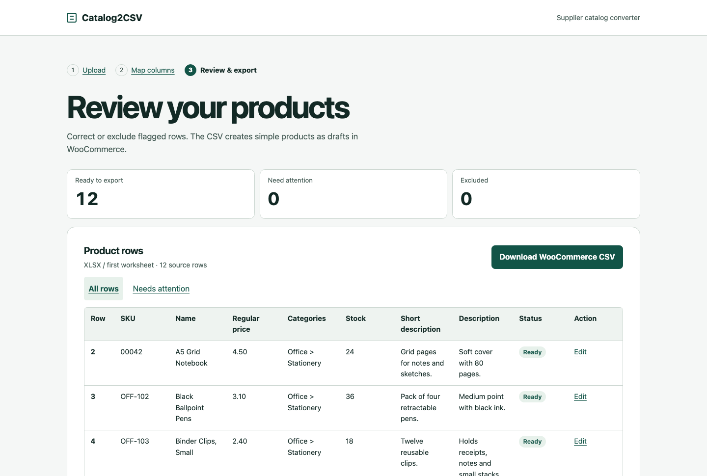

# Catalog2CSV

Convert a supplier’s Excel or CSV price list into a checked, import-ready
WooCommerce product CSV. Run the converter on your own PHP hosting.

**Supplier spreadsheet → map columns → fix flagged rows → download CSV → import into WooCommerce**

WooCommerce's built-in importer accepts CSV. Catalog2CSV handles the work
upstream: opening XLSX, mapping supplier headers, normalizing decimal commas,
finding missing prices and duplicate SKUs, and allowing row corrections or
exclusions before generating the CSV.



## Try it

1. Open the app and choose **Open sample catalog**, or upload the
   [sample supplier XLSX](examples/supplier-catalog.xlsx).
2. Check the suggested mappings for **SKU**, **Name** and **Regular price**.
   To try a comma-decimal file, use the [sample supplier CSV](examples/supplier-catalog.csv)
   and choose **Comma** under **Decimal mark in text prices**.
3. Choose **Review products** and open any flagged row to fix or exclude it.
4. Download the CSV. Compare it to the
   [expected WooCommerce CSV](examples/woocommerce-products.csv).
5. On a test store, go to **Products → All Products → Import**. Select your CSV
   and leave **Update existing products** unchecked. Confirm the mapping,
   run the importer, and check the resulting drafts.

For a larger, independently published example, upload the
[DataBrighten 100-product Excel catalog](examples/public/databrighten-inventory-100.xlsx).
See its [mapping, source and credit](examples/public/README.md).

## Deploy

Use the prebuilt deployment ZIP for Plesk, cPanel or Apache shared hosting.
It includes the locked Composer dependencies and works without Composer on
the server. See the [deployment guide](docs/DEPLOYMENT.md) for document-root,
subfolder and database setup.

For a source checkout with PHP 8.3+ and Composer 2:

```sh
composer install
cp config/config.example.php config/config.local.php
php tools/password.php
```

Create a fresh MariaDB or MySQL database and import
[`database/001-create-jobs.sql`](database/001-create-jobs.sql). Fill in the
database settings and generated access hash in your local config, then run:

```sh
php -d memory_limit=256M -d upload_max_filesize=6M -d post_max_size=7M -S 127.0.0.1:8000 -t public
```

Visit [the local workspace](http://127.0.0.1:8000/) and sign in as the access
user defined in the config. A production deployment requires HTTPS.

## Input and output

| Area | Supported behavior |
| --- | --- |
| Input | UTF-8 CSV with optional BOM and comma, semicolon or tab delimiter, or the first worksheet of an XLSX workbook. Headers belong on row 1. |
| Required | SKU, product name and non-negative regular price. Select the decimal mark for CSV and text prices. Format zero-padded or long Excel SKUs as text. |
| Optional | Categories, whole-number stock, short description and description. Use commas between categories and `>` between levels. Quantity zero exports as out of stock. |
| Review | Duplicate SKU checks ignore case. Fix or exclude invalid rows. XLSX formulas and errors in mapped cells need correction. Text that resembles a spreadsheet formula cannot be exported. |
| Output | UTF-8 WooCommerce CSV for simple draft products. Prices use a dot. Unmapped optional fields are omitted. No currency conversion, tax calculation or markups are applied. |
| Limits | 5 MiB upload, 5,000 data rows, 32 columns, 80,000 cells and 8 KiB per cell. Split larger catalogs. |
| Scope | New simple products. Images, variations, bundles, live inventory sync, and direct store connections are outside the current release. |

Files are processed on the deployment. The original upload is temporary.
Parsed cells, mappings and edits are accessible to the originating browser
session until discarded, replaced or expired after 24 hours. Schedule the
cleanup command as described in the deployment guide.

## Develop and verify

```sh
composer validate --strict
composer lint
composer test
composer audit --locked
```

See [test environments and results](docs/TESTING.md),
[contributing](CONTRIBUTING.md), [security reporting](SECURITY.md) and the
[changelog](CHANGELOG.md).

## License and credits

[MIT](LICENSE) for the original project. See [third-party notices](THIRD_PARTY_NOTICES.md)
and [the DataBrighten workbook credit](examples/public/README.md). The CSV
schema is documented in the [WooCommerce importer guide](https://woocommerce.com/document/product-csv-importer-exporter/).
